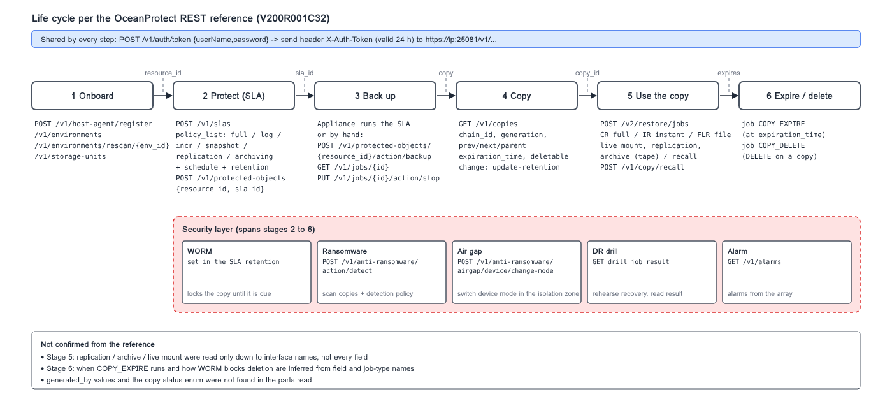
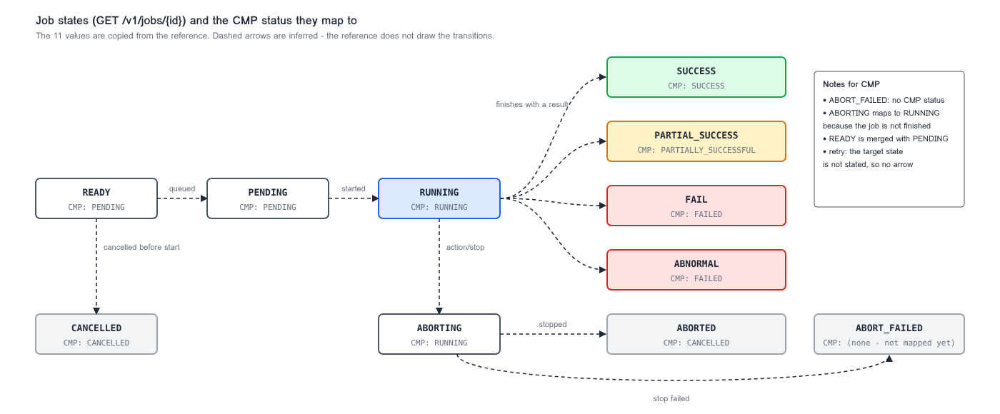
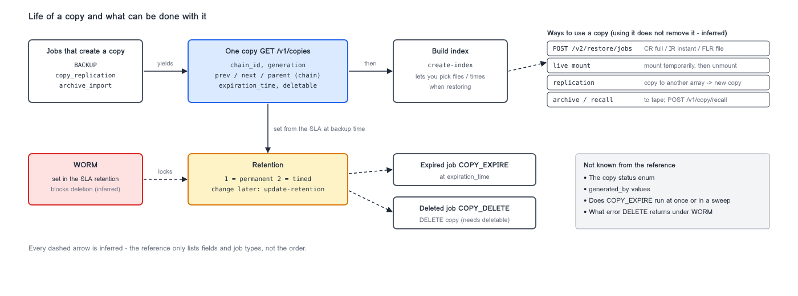
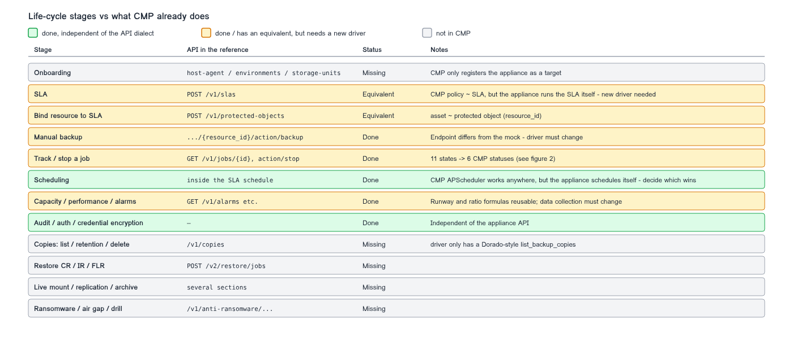

# OceanProtect life cycle per the REST reference

Summary of the *OceanProtect Appliance V200R001C32 REST Interface Reference*: what the API supports,
and how much of it CMP covers today. The figures are generated from `docs/diagrams/*.svg`.

## 1. Six stages

Onboard, protect (SLA), back up, copy, use the copy, expire/delete. A security layer (WORM, ransomware
detection, air gap, DR drill) spans stages 2 to 6.

Key point: **the schedule lives in the SLA on the appliance**. The appliance runs backups by itself;
a manual backup call is an optional extra.

## 2. Job states

The reference lists 11 job states but does not draw the transitions, so the dashed arrows are our inference.
`ABORT_FAILED` has no CMP status yet.

## 3. Life of a copy

## 4. CMP coverage

Green: reusable as is. Amber: exists but needs a new driver for the real API. Grey: not built.
The agreed next step is a new mock and driver on the real API (`/v1`, `X-Auth-Token`).

## Not confirmed

- Replication, archive, live mount, ransomware, air gap and DR drill were read only down to interface names.
- Job and copy transitions are inferred.
- The copy status enum and `generated_by` values were not found in the parts read.
- Stopping a job is `PUT /v1/jobs/{jobId}/action/stop` (not POST).
